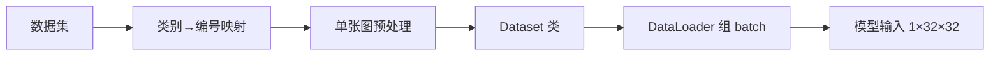

# [[SimpleCNN]] 四分类动物识别：从模型到训练的完整学习总结

> 本文档整合了两处内容：当前主会话（SimpleCNN 片段修复与四分类动物识别），以及本会话**右侧派生的临时会话**（ImageFolder 与 Dataset 的区别、梯度、反向传播三个追问）。全文以你提出的问题为主线展开。

---

## 目录

1. [你的提问全景](#一你的提问全景)
2. [模型结构：SimpleCNN 片段](#二模型结构simplecnn-片段)
3. [从读图到模型输入要补哪些部分](#三从读图到模型输入要补哪些部分)
4. [进模型之后的顺序与做法](#四进模型之后的顺序与做法)
5. [五步训练的数值演示](#五五步训练的数值演示)
6. [右侧临时会话的三个追问（重点）](#六右侧临时会话的三个追问重点)
7. [后续实践路线](#七后续实践路线)

---

## 一、你的提问全景

| 序号 | 你的问题 | 来源 |
| --- | --- | --- |
| 1 | 贴出带注释的 SimpleCNN 代码片段，需要理清结构和注释 | 主会话 |
| 2 | 动物四分类（猫/狗/鸭子/其他），已有数据集，从读图到进模型要补哪些部分 | 主会话 |
| 3 | 进模型后：算损失、优化参数、训练、验证精度、混淆矩阵按什么顺序、怎么做 | 主会话 |
| 4 | 用一组实际数据演示训练五步里数据如何变化 | 主会话 |
| 5 | ImageFolder 与 Dataset 的区别 | 右侧临时会话 |
| 6 | 什么是梯度，有什么用 | 右侧临时会话 |
| 7 | 什么是反向传播，它具体做了什么，数值如何变化 | 右侧临时会话 |

---

## 二、模型结构：SimpleCNN 片段

**你的问题**：贴出了一段 SimpleCNN 代码片段（注释在粘贴中被打散成乱码），需要把结构理清。

这是一个面向 `1×32×32` 灰度输入的四分类卷积网络，数据流如下：


| 层 | 类型 | 输入 → 输出形状 | 说明 |
| --- | --- | --- | --- |
| conv1 | 卷积 3×3 | 1×32×32 → 8×32×32 | 1→8 通道，padding=1 保持尺寸 |
| ReLU | 激活 | 8×32×32 | 负数清零，形状不变 |
| pool | 最大池化 2×2 | 8×32×32 → 8×16×16 | 尺寸减半 |
| conv2 | 卷积 3×3 | 8×16×16 → 16×16×16 | 8→16 通道 |
| ReLU | 激活 | 16×16×16 | 形状不变 |
| pool | 最大池化 2×2 | 16×16×16 → 16×8×8 | 尺寸再减半 |
| flatten | 展平 | 16×8×8 → 1024 | 拉成一维 |
| fc1 | 全连接 | 1024 → 64 | 综合特征 |
| fc2 | 输出 | 64 → 4 | 4 个类别分数 |

整理后可直接运行的模型（可训练参数 **67108** 个）：

```python
import torch
import torch.nn as nn
import torch.nn.functional as F

class SimpleCNN(nn.Module):
    def __init__(self, num_classes=4):
        super().__init__()
        self.conv1 = nn.Conv2d(1, 8, kernel_size=3, padding=1)
        self.pool = nn.MaxPool2d(kernel_size=2, stride=2)
        self.conv2 = nn.Conv2d(8, 16, kernel_size=3, padding=1)
        self.fc1 = nn.Linear(16 * 8 * 8, 64)
        self.fc2 = nn.Linear(64, num_classes)

    def forward(self, x):
        x = F.relu(self.conv1(x))   # (B,1,32,32) -> (B,8,32,32)
        x = self.pool(x)            # -> (B,8,16,16)
        x = F.relu(self.conv2(x))   # -> (B,16,16,16)
        x = self.pool(x)            # -> (B,16,8,8)
        x = x.flatten(1)            # -> (B,1024)
        x = F.relu(self.fc1(x))     # -> (B,64)
        return self.fc2(x)          # -> (B,4)
```

相对原片段只做了三处修正：补上导入、恢复粘贴时丢失的缩进、把 `x.view(x.size(0), -1)` 换成 `x.flatten(1)`（语义相同，对非连续张量更安全）。

---

## 三、从读图到模型输入要补哪些部分

**你的问题**：动物四分类（猫、狗、鸭子、其他），假设已有数据集，从读取图像到处理到模型输入，需要补充哪几个部分？

从"已有数据集"到"能喂进模型"，缺的是完整的数据管线，共五部分：



1. **确定数据集格式**：按文件夹分类（`data/train/cat` 等），或"图片堆一起 + 一张标签表"。两种读取方式完全不同。
2. **类别到编号映射**：模型输出 0/1/2/3，需稳定映射 `{"cat":0, "dog":1, "duck":2, "other":3}`。`ImageFolder` 默认按字母序编号，中文文件夹名顺序不可控，要显式指定。
3. **单张图预处理**：Resize 到 32×32 → Grayscale 转单通道 → ToTensor（0~1 的 `(C,H,W)`）→ 可选 Normalize。
4. **自定义 Dataset**：把"路径 + 标签"变成 `(图像张量, 类别编号)`，实现 `__len__` 和 `__getitem__`。
5. **DataLoader**：组 batch、随机打乱、多进程读取。

关键提醒：模型是**单通道灰度**输入，而动物照片多为彩色 RGB，所以要么预处理转灰度（保持模型不动），要么把 `conv1` 改成 `in_channels=3`（保留颜色，但要改模型）。训练、验证、测试必须用同一套预处理。

对应骨架：

```python
from PIL import Image
from torch.utils.data import Dataset, DataLoader
from torchvision import transforms

CLASSES = ["cat", "dog", "duck", "other"]
class_to_idx = {c: i for i, c in enumerate(CLASSES)}

transform = transforms.Compose([
    transforms.Resize((32, 32)),
    transforms.Grayscale(num_output_channels=1),
    transforms.ToTensor(),
    transforms.Normalize((0.5,), (0.5,)),
])

class AnimalDataset(Dataset):
    def __init__(self, image_paths, labels, transform=None):
        self.image_paths, self.labels, self.transform = image_paths, labels, transform
    def __len__(self):
        return len(self.image_paths)
    def __getitem__(self, idx):
        img = Image.open(self.image_paths[idx])
        return (self.transform(img), self.labels[idx]) if self.transform else (img, self.labels[idx])

loader = DataLoader(dataset, batch_size=32, shuffle=True, num_workers=0)
```

关于"用现成的 ImageFolder 还是自己写 Dataset"，详见 [6.1](#61-imagefolder-与-dataset-的区别)。

---

## 四、进模型之后的顺序与做法

**你的问题**：进模型之后，到计算损失、优化参数、训练、验证精度、混淆矩阵，按什么顺序进行、如何进行？

这是一条**内循环套外循环**的固定流水线。训练时每个 batch 反复做五步（内循环）：

1. 前向 `forward` → 4 个类别分数（logits）
2. `CrossEntropyLoss` 算损失
3. `optimizer.zero_grad()` 清梯度
4. `loss.backward()` 反向传播，算每个参数的梯度
5. `optimizer.step()` 按梯度更新参数

所有 batch 跑完算一个 epoch，然后进入验证（外循环）：切 `eval()`、包 `no_grad()`，只前向统计精度；重复若干 epoch；最后在测试集上出混淆矩阵。

三个易错点：梯度是**累加**的，`zero_grad()` 必须在 `backward()` 之前；最后一层**不要加 softmax**（`CrossEntropyLoss` 内部已含）；验证时用 `no_grad()` 不更新参数。

```python
model = SimpleCNN(num_classes=4)
criterion = nn.CrossEntropyLoss()
optimizer = torch.optim.Adam(model.parameters(), lr=1e-3)

for epoch in range(EPOCHS):
    model.train()
    for x, y in train_loader:
        optimizer.zero_grad()
        loss = criterion(model(x), y)
        loss.backward()
        optimizer.step()

    model.eval()
    correct = total = 0
    with torch.no_grad():
        for x, y in val_loader:
            preds = model(x).argmax(dim=1)
            correct += (preds == y).sum().item()
            total += y.size(0)
    val_acc = correct / total
```

混淆矩阵放在最后，在**没参与训练的测试集**上收集真实标签与预测标签：

```python
from sklearn.metrics import confusion_matrix, classification_report
cm = confusion_matrix(all_labels, all_preds, labels=[0, 1, 2, 3])
print(cm)
print(classification_report(all_labels, all_preds,
      target_names=["cat", "dog", "duck", "other"]))
```

4×4 矩阵**行是真实类别、列是预测类别**，对角线是分对的个数，非对角线告诉你每类具体被错分到了哪一类（比如"很多狗被判成猫"）。

---

## 五、五步训练的数值演示

**你的问题**：用一组实际数据，生动演示训练五步各处理了什么、数据如何改变。

为了看清每个数，用一个"4 特征 → 4 类"的缩小模型（真实 CNN 里 4 个特征对应展平后的 1024 维，逻辑一致），学习率 0.1，一批 3 个样本：

| 样本 | 4 个特征 | 真实类别 |
| --- | --- | --- |
| 0 | [1, 2, 3, 4] | 猫(0) |
| 1 | [2, 0, 1, 1] | 鸭子(2) |
| 2 | [0, 1, 0, 2] | 狗(1) |

**第 1 步 前向**：随机权重算出三个样本的 logits，取每行最大得预测，结果**全预测成"狗"(1)**，只有样本 2 对：

```
样本0: [-2.17,  1.63, -0.63, -1.68]  → 预测 1
样本1: [-0.79,  0.00, -0.34, -1.14]  → 预测 1
样本2: [-0.47,  0.93, -0.06, -0.29]  → 预测 1
```

**第 2 步 损失**：`loss = 1.9518`，这个数越大说明预测越离谱。

**第 3、4 步 反向与梯度**：`backward()` 算出梯度存进 `W.grad`，看最有信息量的两行：

| 对应类别 | 梯度符号 | 含义 |
| --- | --- | --- |
| 猫(0) 行 | 全负 `[-0.205, -0.611, -0.920, -1.161]` | 上调这类权重能减小损失 |
| 狗(1) 行 | 全正 `[0.555, 0.414, 0.994, 0.962]` | 下调这类权重能减小损失 |

也就是模型在"把分数从错误的狗，扳回正确的猫"。若不清零再 `backward()`，梯度会翻倍（累加），所以 `zero_grad()` 必须在前。

**第 5 步 更新**：`W_new = W_old - lr × grad`，拿第一列权重看：

| 权重 | 更新前 | 更新后 | 变化 |
| --- | --- | --- | --- |
| 猫行第一列 | -0.0037 | +0.0168 | +0.0205（=0.1×0.205） |
| 狗行第一列 | -0.1926 | -0.2481 | -0.0555（=0.1×0.555） |

**结果**：同一批数据再走一遍，损失从 `1.9518` 降到 `1.4648`，狗的分数明显被压低。

一句话总结：**前向算分数 → 损失量化"错多离谱" → 反向算每个权重的修正方向 → 优化器执行修正 → 反复循环把损失越压越小**。验证精度和混淆矩阵则是在循环结束后，用没参与训练的图片检查权重到底拧对了没有。

---

## 六、三个追问（重点）

### 6.1 ImageFolder 与 Dataset 的区别

一句话：`ImageFolder` 本身就是 `Dataset` 的一个现成子类，专门服务"每类一个文件夹"的数据布局；`Dataset` 是通用基类，需要你自己实现读取逻辑。二者不是对立的二选一，而是"通用基类 vs 现成实现"。

| 维度 | ImageFolder | 自定义 Dataset |
| --- | --- | --- |
| 是什么 | torchvision 内置的 Dataset 子类 | 继承 `torch.utils.data.Dataset` 自己实现 |
| 数据布局 | 必须是 `root/类别名/图片` | 任意，可接 CSV/JSON 标签表 |
| 标签来源 | 按文件夹名自动编号（默认字母序） | 自己定义，完全可控 |
| 代码量 | 几行 | 需写 `__len__` 和 `__getitem__` |
| 适用场景 | 数据已按类分好文件夹 | 图片与标签分离、需自定义读取或预处理 |

```python
from torchvision.datasets import ImageFolder
from torchvision import transforms

transform = transforms.Compose([
    transforms.Resize((32, 32)),
    transforms.Grayscale(num_output_channels=1),
    transforms.ToTensor(),
])

# 数据已按文件夹分好类，直接一行搞定
ds = ImageFolder("data/train", transform=transform)
print(ds.classes)       # 类别名列表，默认按字母序
print(ds.class_to_idx)  # 类别名 -> 编号 的映射

# 需要自定义时（图片 + 标签表 / 特殊逻辑）
from torch.utils.data import Dataset
from PIL import Image

class AnimalDataset(Dataset):
    def __init__(self, image_paths, labels, transform=None):
        self.image_paths, self.labels, self.transform = image_paths, labels, transform
    def __len__(self):
        return len(self.image_paths)
    def __getitem__(self, idx):
        img = Image.open(self.image_paths[idx])
        return (self.transform(img), self.labels[idx]) if self.transform else (img, self.labels[idx])
```

注意点：`ImageFolder` 默认按文件夹名字母序给编号，中文文件夹名顺序不可控，可显式覆盖 `ds.class_to_idx = {"cat":0, "dog":1, "duck":2, "other":3}` 再同步 `ds.samples`。

### 6.2 什么是梯度，有什么用

梯度是"多变量版的导数"：对损失 L 和某个权重 w，梯度 ∂L/∂w 表示"w 动一点点，损失会随之变化多少、往哪个方向变"。

| 梯度符号 | 含义 | 该怎么做 |
| --- | --- | --- |
| 正 | 增大 w 会增大损失 | 减小 w |
| 负 | 增大 w 会减小损失 | 增大 w |

它的用途就是告诉优化器"每个参数该往哪个方向、按多大比例调整，才能让损失下降得最快"，也就是梯度下降：

```
w ← w - lr × grad
```

直接呼应第五节数值演示：猫(0)行的梯度全负 → 权重被上调；狗(1)行的梯度全正 → 权重被下调。`lr`（学习率）控制每次调整的步子大小。

### 6.3 什么是反向传播，它具体做了什么，数值如何变化

前向传播是从输入算出损失；反向传播是反过来，用**链式法则**把损失对每个参数的梯度一层层算出来、存进 `.grad`。

用最简单的单层走一遍数字：设 `z = w·x`，损失 `loss = (z - y)²`，取 `w=2, x=3, y=1`。

前向：`z = 2×3 = 6`，`loss = (6-1)² = 25`。

反向（链式法则分两步）：

- `∂loss/∂z = 2(z - y) = 2×5 = 10`
- `∂z/∂w = x = 3`
- `∂loss/∂w = ∂loss/∂z × ∂z/∂w = 10×3 = 30`

所以 w 的梯度是 30。按梯度下降 `w ← 2 - lr×30`，取 `lr=0.01`，w 变成 `1.7`，z 从 6 往 1 靠，损失下降。`loss.backward()` 做的就是把这段链式求导在整张计算图上自动跑一遍。

把它放到完整训练里，数值变化正是第五节演示的：`backward()` 后 `W.grad` 出现梯度数值；不清零再 `backward()` 梯度会累加翻倍；`zero_grad()` 后变 `None`；`step()` 后权重被更新，损失从 `1.9518` 降到 `1.4648`。

---

## 七、后续实践路线

1. 先跑 `SimpleCNN` 形状自检，确认维度流转。
2. 按数据实际目录结构补 `Dataset`（或直接用 `ImageFolder`），把图片变成 `(1,32,32)` 张量。
3. 写训练循环（内循环五步 + 外循环验证）。
4. 测试集上出混淆矩阵，定位"哪两类容易混"。
5. 若过拟合，再加数据增强、BatchNorm、Dropout，或把池化换成 stride 卷积对比精度。

---

*本文档对应的可运行文件：[simple_cnn.py](C:/Users/ZHANG-YUBO/Documents/Codex/2026-10-15/fourclass-classification-task/outputs/simple_cnn.py)（模型）与 [demo_train_steps.py](C:/Users/ZHANG-YUBO/Documents/Codex/2026-10-15/fourclass-classification-task/work/demo_train_steps.py)（五步数值演示）。*
